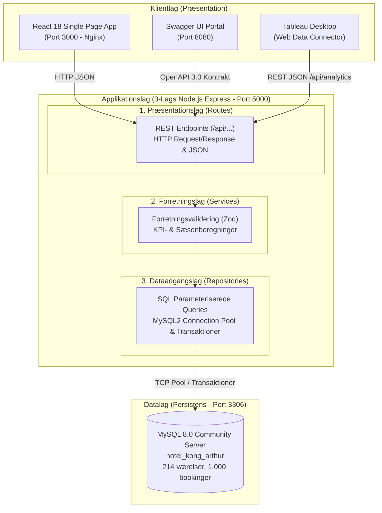

# Hotel Kong Arthur — Booking-CRUD & Analytics Platform (SCAMM)

[]()
[]()
[]()
[]()
[]()

Dette repository indeholder den komplette, integrerede prototype for **Hotel Kong Arthur** udviklet af **Team SCAMM** i forbindelse med 3. semesters tværfaglige opgave i softwarearkitektur.

Systemet understøtter hotellets daglige receptionsdrift (oprettelse, søgning, ændring og aflysning af reservationer) samt strategiske ledelsesanalyser via Tableau (omsætning, sæsoner, belægningsgrad og lobbybarens salgstransaktioner).

---

## 🏛️ Overordnet Systemarkitektur (3-Lags Model)

Systemet er strikt opbygget efter Separation of Concerns i en klassisk 3-lags softwarearkitektur:



---

## 🚀 Hurtig Opstart (Quickstart)

### Forudsætninger
* [Docker Desktop](https://www.docker.com/products/docker-desktop/) (v24+ med Docker Compose v2)
* [Git](https://git-scm.com/)

### 1. Klon repositoryet og skift til `development`:
```bash
git clone https://github.com/Junkersje/Hotel-Kong-Arthur-SCAMM-Tv-rfaglig-Opgave.git
cd Hotel-Kong-Arthur-SCAMM-Tv-rfaglig-Opgave
git checkout development
```

### 2. Opret miljøvariabler:
```bash
cp .env.example .env
```

### 3. Start hele systemet med én kommando:
```bash
docker-compose up --build -d
```

Alle 4 containere (`hotel-mysql`, `hotel-backend`, `hotel-frontend`, `hotel-swagger-ui`) oprettes, forbindes og starter automatisk op. Databasen initialiseres automatisk med samtlige tabeller, 214 værelser, 30 produkter og 1.000 eksempelbookinger.

---

## 🌐 Services, Port-adresser & Værktøjer

| Service | Port | Beskrivelse | URL |
| :--- | :---: | :--- | :--- |
| **Frontend UI** | `3000` | Receptionsportal (React SPA serveret via Nginx) | [http://localhost:3000](http://localhost:3000) |
| **Backend REST API** | `5000` | 3-lags Express.js REST API | [http://localhost:5000/api/health](http://localhost:5000/api/health) |
| **Swagger UI** | `8080` | Interaktiv OpenAPI 3.0 dokumentation og sandkasse | [http://localhost:8080](http://localhost:8080) |
| **Backend Swagger Docs** | `5000` | Swagger UI serveret direkte fra Node.js | [http://localhost:5000/api-docs](http://localhost:5000/api-docs) |
| **MySQL 8.0 Database** | `3306` | Persistent relationel database (`hotel_data`) | `localhost:3306` |

---

## 👥 Team SCAMM — Ansvarsfordeling & Vertikale Spor

Systemet er opdelt i 5 uafhængige, parallelle spor:

| Medlem | Rolle | Primære Jira Tickets | Omfang / Fil-ejerskab |
| :--- | :--- | :--- | :--- |
| **Mathias** | **DevOps, Infrastruktur & Samlet QA** | `SH-1 – SH-12`, `SH-51 – SH-54` | Docker Compose, MySQL connection pool, middleware, `README.md`, `CONTRIBUTE.md`, E2E test og converge-rapport. |
| **Amira** | **Receptionsskranke & Oprettelse (MVP)** | `SH-13 – SH-21` | Zod-validering, gæste- & bookingoprettelse, `BookingForm.jsx` og `POST /api/bookings`. |
| **Christoffer**| **Booking Directory & Livscyklus** | `SH-22 – SH-32` | Reaktiv søgning, redigering af datoer, soft delete (`status = 'cancelled'`), `BookingList.jsx` og `PUT/DELETE`. |
| **Simon** | **Hotel Finance & Belægningsanalyse** | `SH-33 – SH-42` | Hotelomsætning, sæsoninddeling (lav/mellem/høj), belægningsprocent baseret på 214 værelser, KPI endpoints. |
| **Maja** | **Lobby Bar Analytics & Tableau WDC** | `SH-43 – SH-50` | Baromsætning, Helene Christine (`EMP-01`) cocktail/kaffesalg, geografi og Tableau Web Data Connector (`tableau-wdc.html`). |

---

## 📊 Databasens Grundbestand

Databasen initialiseres med faktiske og konsistente data:
* **Værelser**: Præcis **214 fysiske værelser** fordelt over 5 etager.
* **Værelsestyper**: 8 officielle kategorier (Standard Single, Grand Lit, Standard Double, Superior Double, Junior Suite, Spa Executive, Suite, LOFT Suite).
* **Varer**: 20 signaturcocktails og 10 specialkaffer med priser i DKK.
* **Personale**: Bartender & receptionist Helene Christine (ID: `EMP-01`) m.fl.
* **Historik**: 1.000 seedede reservationer og 1.200 barsalgstransaktioner med gæster fra 20+ lande.

---

## 🧪 Kvalitetssikring & Drift

For fejlfinding og verifikation af containerne:

```bash
# Tjek containerstatus og healthchecks
docker-compose ps

# Følg backend-logs i realtid
docker-compose logs -f backend

# Fuld genstart med bibeholdelse af data på volume
docker-compose restart

# Nulstil alt inkl. database-volumen (ren genstart)
docker-compose down -v
docker-compose up --build -d
```

Se retningslinjer for branches, commits og PR's i [CONTRIBUTE.md](./CONTRIBUTE.md).  
Se den detaljerede arkitektur- og testplan i [specs/001-hotel-management/plan.md](./specs/001-hotel-management/plan.md).
