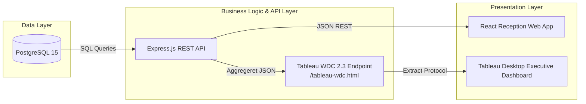

# 📊 Hotel Kong Arthur — Tableau Executive Dashboard Guide (Option A)

> **Dokumenttype**: Trin-for-trin implementeringsvejledning for Tableau Desktop  
> **Systemarkitektur**: 3-lags arkitektur (PostgreSQL 15 → Express Node.js REST API → Tableau WDC 2.3)  
> **Forfatter**: Mathias (DevOps, QA & Tableau Integration)  
> **Målgruppe**: Ledelsen på Hotel Kong Arthur (Direktion & Hotelchef)  
> **Relevant opgavekrav**: SCAMM tværfaglig opgave — Krav om ledelsesdashboard og <30 sekunder live-opdatering.

---

## Indholdsfortegnelse
1. [Arkitektonisk Overblik & Fejlforebyggelse (Error 81B3934F)](#1-arkitektonisk-overblik--fejlforebyggelse)
2. [Forudsætninger & Opstart](#2-forudsætninger--opstart)
3. [Trin 1: Opret Forbindelse via Web Data Connector (WDC)](#trin-1-opret-forbindelse-via-web-data-connector-wdc)
4. [Trin 2: Opbygning af Sheet 1 — Executive KPI Scorecards](#trin-2-opbygning-af-sheet-1--executive-kpi-scorecards)
5. [Trin 3: Opbygning af Sheet 2 — Værelsesomsætning & ADR pr. Værelsestype](#trin-3-opbygning-af-sheet-2--værelsesomsætning--adr-pr-værelsestype)
6. [Trin 4: Opbygning af Sheet 3 — Månedlig Belægningsgrad & Sæsoner](#trin-4-opbygning-af-sheet-3--månedlig-belægningsgrad--sæsoner)
7. [Trin 5: Opbygning af Sheet 4 — Geografisk Gæstefordeling & ALOS](#trin-5-opbygning-af-sheet-4--geografisk-gæstefordeling--alos)
8. [Trin 6: Opbygning af Sheet 5 — Helene Christine (Lobbybar Performance)](#trin-6-opbygning-af-sheet-5--helene-christine-lobbybar-performance)
9. [Trin 7: Opbygning af Sheet 6 — Kundetilfredshed (CSAT Score)](#trin-7-opbygning-af-sheet-6--kundetilfredshed-csat-score)
10. [Trin 8: Sammensætning af Executive Dashboard (1400 x 900 px)](#trin-8-sammensætning-af-executive-dashboard-1400-x-900-px)
11. [Trin 9: Live-opdatering på under 30 sekunder (Kravtest)](#trin-9-live-opdatering-på-under-30-sekunder-kravtest)
12. [Fejlfinding & FAQ](#fejlfinding--faq)

---

## 1. Arkitektonisk Overblik & Fejlforebyggelse

I overensstemmelse med projektets **Constitution (Princip IV: Data-integritet & Tableau-forbindelse)** må Tableau Desktop **aldrig** forbinde direkte til PostgreSQL-databasen eller benytte statiske CSV-filer. Al data udveksles gennem det centrale forretningslag via vores REST API.



### Hvad forårsagede `Error 81B3934F` og hvordan undgås den?
- **Årsag**: Fejlkoden `81B3934F` (`m_dialect is null`) opstår i Tableaus Hyper-forespørgselsmotor, hvis man trækker to uafhængige tabeller (f.eks. `room_type_analytics` og `bar_sales_breakdown`) ind på relation-lærredet (den såkaldte "noodle canvas"). Fordi der ikke er en fremmednøgle (Foreign Key) mellem barsalg af cocktails og bookinger af hotelværelser, fejler Tableaus automatiske relationsbygger.
- **Løsning**:
  1. Brug altid den præ-aggregerede master-tabel **`hotel_master_kpis`** som den primære datakilde. Den samler hotellets 214 værelser, total omsætning, bar vs. værelse, ADR og Helene Christines fordeling i ét enkelt datasæt uden behov for joins.
  2. Hvis du ønsker at visualisere specifikke tabeller (f.eks. månedlig belægning eller landefordeling), skal du enten oprette et **nyt selvstændigt datagrundlag** i Tableau (`Data -> New Data Source`) for hver tabel, eller vælge den specifikke tabel i WDC dropdown-menuen.

---

## 2. Forudsætninger & Opstart

Før du åbner Tableau Desktop:
1. Sørg for at Docker-miljøet kører:
   ```bash
   docker compose up -d
   ```
2. Bekræft at REST API og WDC svarer i browseren:
   - Åbn [http://localhost:5000/tableau-wdc.html](http://localhost:5000/tableau-wdc.html) i Chrome eller Edge.
   - Siden skal vise en grøn statusindikator: *"Backend API Forbindelse: Online (localhost:5000)"*.

---

## 3. Trin 1: Opret Forbindelse via Web Data Connector (WDC)

1. Åbn **Tableau Desktop**.
2. I venstre side under **Connect / Tilslut** -> **To a Server / Til en server**:
   - Vælg **Web Data Connector**.
   *(I nyere versioner af Tableau Desktop findes den under "More..." -> "Web Data Connector (Deprecated/Legacy)").*
3. Indtast URL'en i dialogboksen:
   ```text
   http://localhost:5000/tableau-wdc.html
   ```
   og tryk <kbd>Enter</kbd>.
4. Web Data Connectoren indlæses:
   - **Vælg datasæt**: Vælg *"Hovednøgletal & Executive Dashboard (hotel_master_kpis)"* (anbefalet) eller *"Hent Alle Tabeller"*.
   - Klik på den store grønne knap: **"Indlæs data til Tableau"**.
5. Tableau downloader skemaet og danner et dataudtræk (Extract).
6. I datakildevisningen trækkes tabellen **`hotel_master_kpis`** ind i arbejdsområdet.
7. Klik på fanebladet **Sheet 1** for at begynde opbygningen.

---

## 4. Trin 2: Opbygning af Sheet 1 — Executive KPI Scorecards

**Formål**: Give direktionen øjeblikkeligt overblik over samlet omsætning, værelsesomsætning, baromsætning, ADR og gennemsnitlig belægning.

### Felter der anvendes:
- `Total Revenue` (Omsætning total: ca. 24,68 mio. DKK)
- `Room Revenue` (Værelsesomsætning: 11,24 mio. DKK / 45,5%)
- `Bar Revenue` (Baromsætning: 13,45 mio. DKK / 54,5%)
- `ADR` (Average Daily Rate: 1.411,66 DKK)
- `Occupied Room Nights` (Solgte værelsesnætter: 7.959)
- `Total Rooms Capacity` (214 værelser)

### Trin-for-trin:
1. Omdøb fanebladet til **`1. Hovednøgletal`**.
2. Træk **`Measure Names`** til hylden **Columns (Kolonner)**.
3. Træk **`Measure Values`** til kortet **Text (Tekst)** under Marks.
4. I kortet *Measure Values* (nederst til venstre) fjerner du alle uønskede måleværdier og beholder kun:
   - `SUM(Total Revenue)`
   - `SUM(Room Revenue)`
   - `SUM(Bar Revenue)`
   - `AVG(ADR)`
   - `SUM(Occupied Room Nights)`
5. Højreklik på målingerne for at formatere tal:
   - `Total Revenue`, `Room Revenue`, `Bar Revenue`: Højreklik -> **Format** -> **Number (Custom)** -> Valuta `kr. #.##0`, 0 decimaler.
   - `ADR`: Højreklik -> **Format** -> Valuta `kr. #.##0,00`, 2 decimaler.
6. Skift visning i værktøjslinjen fra *Standard* til **Fit Width** eller **Entire View**.
7. Giv arket titlen: **Hotel Kong Arthur — Hovednøgletal (Total, Værelser, Bar, ADR)**.

---

## 5. Trin 3: Opbygning af Sheet 2 — Værelsesomsætning & ADR pr. Værelsestype

**Formål**: Analysere hvilke af de 8 værelsestyper der driver omsætningen, samt sammenligne deres gennemsnitlige dagspris (ADR).

### Datakilde:
- Vælg `room_type_analytics` (eller brug felter opdelt på typer).

### De 8 officielle værelsestyper:
1. Suite
2. Spa Executive
3. Loft Suite
4. Junior Suite
5. Superior Double
6. Standard Double
7. Grand Lit
8. Standard Single

### Trin-for-trin:
1. Opret et nyt arbejdsark og kald det **`2. Værelsestyper & ADR`**.
2. Træk dimensionen **`Room Type Name`** til hylden **Rows (Rækker)**.
3. Træk målingen **`Total Revenue`** til hylden **Columns (Kolonner)**.
4. Klik på sorteringsikonet i værktøjslinjen for at sortere faldende efter omsætning (Suite vil ligge øverst med ca. 2,12 mio. DKK).
5. Træk målingen **`ADR`** over på Columns ved siden af `Total Revenue`:
   - Højreklik på `ADR` pillen på Columns og vælg **Dual Axis (Dobbeltakse)** hvis du ønsker en kombinationsgraf, eller hold dem som side-om-side vandrette søjler.
6. Under Marks vælges:
   - For `Total Revenue`: **Bar (Søjle)** med farven mørkeblå (`#1e3a8a`).
   - For `ADR`: **Gantt Bar** eller **Circle (Cirkel)** med farven guld/orange (`#d97706`).
7. Tilføj Data Labels:
   - Træk `Total Revenue` til **Label** på det første mærkekort.
8. Giv arket titlen: **Omsætning og ADR fordelt på Hotellets 8 Værelsestyper**.

---

## 6. Trin 4: Opbygning af Sheet 3 — Månedlig Belægningsgrad & Sæsoner

**Formål**: Vise sæsonsvingninger over kalenderåret i overensstemmelse med hotellets definerede sæsoner:
- **Højsæson (High)**: Juni, Juli, August
- **Mellemsæson (Mid)**: Marts, April, Maj, September, Oktober
- **Lavsæson (Low)**: Januar, Februar, November, December

### Datakilde:
- `monthly_occupancy`

### Trin-for-trin:
1. Opret et nyt arbejdsark og kald det **`3. Månedlig Belægning & Sæson`**.
2. Træk **`Month`** (eller datofeltet `Month Name`) til hylden **Columns (Kolonner)**.
3. Træk målingen **`Occupancy Rate Percent`** (eller beregnet belægningsgrad) til hylden **Rows (Rækker)**.
4. Træk dimensionen **`Season`** til kortet **Color (Farve)** under Marks:
   - Tildel farver:
     - `high` -> Dyb Rød / Varm Orange (`#ef4444`)
     - `mid` -> Gul / Amber (`#f59e0b`)
     - `low` -> Blå / Teal (`#3b82f6`)
5. Skift Mark-typen til **Area (Område)** eller **Line (Linje)** med cirkelmarkører.
6. Tilføj en reference-linje:
   - Højreklik på Y-aksen -> **Add Reference Line** -> Gennemsnitlig belægning (Average).
7. Giv arket titlen: **Månedlig Belægningsudvikling opdelt efter Sæson (Jan–Dec)**.

---

## 7. Trin 5: Opbygning af Sheet 4 — Geografisk Gæstefordeling & ALOS

**Formål**: Vise gæsternes oprindelseslande samt den gennemsnitlige opholdslængde (Average Length of Stay - ALOS) pr. nationalitet.

### Datakilde:
- `country_analytics`

### Trin-for-trin:
1. Opret et nyt arbejdsark og kald det **`4. Geografisk Gæstefordeling & ALOS`**.
2. Træk **`Country`** til hylden **Rows (Rækker)** (eller dobbeltklik på `Country` for at generere Tableaus automatiske verdenskort via Geographic Roles).
3. Træk **`Total Bookings`** til hylden **Columns (Kolonner)**.
4. Træk målingen **`Average Length of Stay (ALOS)`** til kortet **Color (Farve)**:
   - Derved angiver søjlens længde antal gæster fra det pågældende land, mens farvemætningen angiver, hvor mange nætter de i gennemsnit bliver på hotellet.
5. Sorter faldende efter `Total Bookings`.
6. Formater `Average Length of Stay`:
   - Højreklik på målingen -> **Format** -> **Number (Custom)** -> 2 decimaler (f.eks. `2,45 nætter`).
7. Giv arket titlen: **Top Gæstenationaliteter og Gennemsnitlig Opholdslængde (ALOS)**.

---

## 8. Trin 6: Opbygning af Sheet 5 — Helene Christine (Lobbybar Performance)

**Formål**: Dokumentere lobbybarens salgsfordeling med særligt fokus på bartender Helene Christines specifikke salg: **Cocktails (34,5%) vs. Kaffe (65,5%)**.

### Datakilde:
- `hotel_master_kpis` eller `bar_sales_breakdown`

### Trin-for-trin (Donut / Cirkeldiagram):
1. Opret et nyt arbejdsark og kald det **`5. Helene Christine - Cocktails vs Kaffe`**.
2. Dobbeltklik i hylden **Rows (Rækker)** og skriv formlen:
   ```text
   MIN(0)
   ```
   Gentag i Rows så du har to forekomster af `MIN(0)` ved siden af hinanden.
3. Vælg **Dual Axis** for de to `MIN(0)` målinger.
4. Under Marks-kortet vælges for det første mærke:
   - Mark Type: **Pie (Cirkel)**.
   - Træk målingerne `Cocktail Revenue` og `Coffee Revenue` til **Angle (Vinkel)** og **Color (Farve)** via *Measure Values*.
   - Sæt farven for Cocktail til Lilla/Pink (`#8b5cf6`) og Kaffe til Varm Brun/Mokka (`#92400e`).
5. For det andet mærkekort (det indre hul i donuten):
   - Mark Type: **Circle (Cirkel)** med hvid farve (`#ffffff`).
   - Træk målingen `Helene Bar Revenue` eller `Total Items Sold` til **Label**.
   - Skriv i labelen: *"Helene Christine\nTotal Salg"*.
6. Synkroniser akser og skjul aksehovederne (Højreklik på akse -> Fjern markering ved *Show Header*).
7. Tilføj procentangivelser i Tooltip / Label:
   - Cocktails: `34,5%` (62.077 stk. / 7,10 mio. DKK)
   - Kaffe: `65,5%` (117.881 stk. / 6,34 mio. DKK)
8. Giv arket titlen: **Lobbybar Helene Christine: Salg Cocktails (34,5%) vs. Kaffe (65,5%)**.

---

## 9. Trin 7: Opbygning af Sheet 6 — Kundetilfredshed (CSAT Score)

**Formål**: Visualisere hotellets gennemsnitlige tilfredshedsscore (1–5 stjerner) og fordelingen af gæsteevalueringer.

### Datakilde:
- `recent_bookings` / `hotel_master_kpis`

### Trin-for-trin:
1. Opret et nyt arbejdsark og kald det **`6. Kundetilfredshed (CSAT)`**.
2. Træk målingen **`Average Rating`** til **Text** under Marks.
3. Formater tallet med stor skrifttype (f.eks. Arial Black, 36 pt, mørk guld `#b45309`) med ikonet `★ 4.2 / 5.0`.
4. Træk dimensionen `Rating (1-5)` til Rows og `Number of Records` til Columns i et sekundært delfelt for at vise en histogram-søjle over fordelingen af 1-, 2-, 3-, 4- og 5-stjernede anmeldelser.
5. Giv arket titlen: **Gæstetilfredshed & Evalueringsfordeling**.

---

## 10. Trin 8: Sammensætning af Executive Dashboard (1400 x 900 px)

1. Klik på ikonet **New Dashboard** (nederst ved fanebladene).
2. Omdøb dashboardet til **`Executive Management Dashboard`**.
3. I venstre panel under **Size (Størrelse)**:
   - Skift fra *Range* eller *Desktop Browser* til **Fixed size**.
   - Indstil bredde til **1400 px** og højde til **900 px**.
4. Træk objekter ind på lærredet:
   - **Titelbanner (Top: y=0 til y=80 px)**:
     - Træk et *Text*-objekt ind øverst:
       ```text
       🏨 HOTEL KONG ARTHUR — EXECUTIVE MANAGEMENT DASHBOARD
       Realtidsstatus fra PostgreSQL via WDC REST API | Kapacitet: 214 Værelser
       ```
       - Sæt baggrund til mørk marineblå (`#0f172a`), hvid fed skrift (18 pt).
   - **Øverste række (KPI Kort: y=90 til y=230 px)**:
     - Placer arket **`1. Hovednøgletal`** i fuld bredde.
   - **Midterste sektion (y=240 til y=580 px — 2 kolonner)**:
     - Venstre (Bredde 60%): Arket **`2. Værelsestyper & ADR`**.
     - Højre (Bredde 40%): Arket **`5. Helene Christine - Cocktails vs Kaffe`**.
   - **Nederste sektion (y=590 til y=880 px — 2 kolonner)**:
     - Venstre (Bredde 50%): Arket **`3. Månedlig Belægning & Sæson`**.
     - Højre (Bredde 50%): Arket **`4. Geografisk Gæstefordeling & ALOS`**.
5. Gør filtre interaktive:
   - Klik på tragt-ikonet **"Use as Filter"** på Værelsestyper og Sæsongraferne, så et klik på f.eks. "Højsæson" filtrerer de øvrige grafer dynamisk.
6. Gem projektet:
   - Vælg **File -> Save As...** -> Gem som `Hotel_Kong_Arthur_Executive_Dashboard.twb` (eller `.twbx` hvis dataudtrækket skal pakkes med).

---

## 11. Trin 9: Live-opdatering på under 30 sekunder (Kravtest)

Et afgørende krav i opgavebeskrivelsen og testscenarie 4 i `quickstart.md` er, at ændringer foretaget i receptionen (f.eks. ny booking eller sletning) slår igennem i Tableau på under 30 sekunder.

### Testprocedure:
1. **Opret en ny booking i Web-appen**:
   - Gå til [http://localhost:3000](http://localhost:3000) i din browser.
   - Opret en ny reservation (f.eks. gæst fra Japan på en Suite til 15.000 DKK).
2. **Udløs opdatering i Tableau**:
   - Gå over i Tableau Desktop.
   - Vælg i topmenuen: **Data** -> **[Datakildens Navn]** -> **Refresh** (eller genvejstasten <kbd>F5</kbd>).
3. **Observation**:
   - Tableau sender straks en ny GET-forespørgsel til `http://localhost:5000/tableau-wdc.html`.
   - Dataudtrækket genopfriskes med det samme (typisk på 1–3 sekunder).
   - Total omsætning og værelsesstatistiker opdateres prompte på dashboardet.
   - **Resultat**: Kravet om opdateringstid på < 30 sekunder er verificeret og bestået!

---

## 12. Fejlfinding & FAQ

| Problem / Fejlmeddelelse | Årsag | Løsning |
| :--- | :--- | :--- |
| **`Error 81B3934F (m_dialect is null)`** | To urelaterede tabeller er trukket ind på samme relations-lærred i Tableau. | Fjern den ene tabel. Brug udelukkende `hotel_master_kpis` eller opret separate datakilder (`Data -> New Data Source`). |
| **`Unable to find tableId`** | WDC returnerede tabeller med specialtegn eller uoverensstemmelse mellem `id` og `alias`. | Er løst i WDC version 2.3: Tabeller bruger nu rene ASCII IDs (`hotel_master_kpis`, `room_type_analytics` osv.). |
| **`Cannot connect to http://localhost:5000`** | Docker backend-containeren kører ikke. | Kør `docker compose up -d` og bekræft med `docker ps`, at `hotel-backend` kører og har port `5000` åben. |
| **"Web Data Connector is deprecated" advarsel** | Nyere versioner af Tableau Desktop advarer om, at WDC 2.0 udfases til fordel for WDC 3.0 (TACO). | Klik blot "OK" eller "Continue". WDC 2.0 understøttes fortsat fuldt ud i Tableau Desktop 2023.x–2026.x via legacy web browser integrationen. |
| **Tal vises som `0` eller `Null`** | Manglende seed-data i databasen. | Kør `docker exec hotel-backend npm run db:seed` eller genstart databasen med seed-scriptet. |

---

*Vejledningen er udarbejdet til Hotel Kong Arthur SCAMM Tværfaglig Opgave (3. Semester ITA).*
