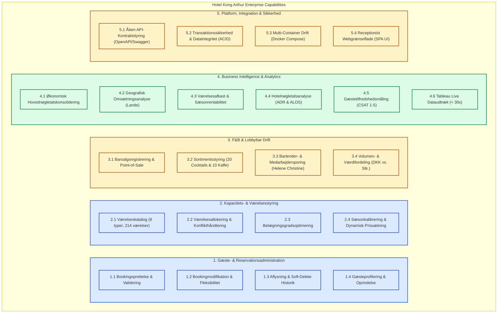
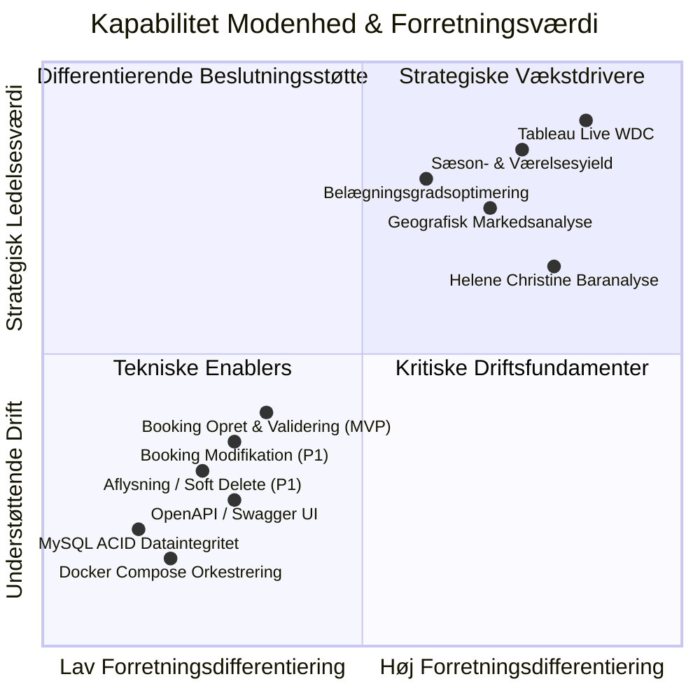

# Capability Map: Hotel Kong Arthur — SCAMM Platform

**Feature**: [spec.md](./spec.md) | **Plan**: [plan.md](./plan.md) | **Tasks**: [tasks.md](./tasks.md)  
**Branch**: `specify` | **Dato**: 2026-10-29  
**Status**: Ratificeret

Dette dokument definerer **Business Capability Map** for Hotel Kong Arthur-platformen (SCAMM). Et Capability Map beskriver *hvad* forretningen og systemet er i stand til at gøre (kapabiliteter), uafhængigt af *hvordan* det implementeres teknologisk, og etablerer den direkte bro mellem forretningskrav, softwarearkitektur og de konkrete user stories.

---

## 1. Visuelt Capability Map (Level 1 & Level 2)

> **Farvekoder for strategisk kapabilitetsrolle**:
> - 🟦 **Kerne (Core)**: Forudsætning for daglig hoteldrift og drift af bookinger.
> - 🟩 **Differentierende (Differentiating)**: Giver ledelsen konkurrencefordele via realtids Business Intelligence og Tableau.
> - 🟨 **Understøttende / Enabler (Supporting)**: Teknisk fundament, kassedrift og containerinfrastruktur.

---

## 2. Detaljeret Kapabilitetskatalog

### Kapabilitetsdomæne 1: Gæste- & Reservationsadministration
*Formål*: Sikre problemfri modtagelse, administration og historik for hotellets gæster og reservationer.

| Kapabilitet ID | Navn | Beskrivelse (Hvad forretningen kan) | Strategisk Type | Relaterede User Stories | Relaterede Tasks |
| :--- | :--- | :--- | :--- | :--- | :--- |
| **CAP-1.1** | Bookingoprettelse & Validering | Oprette nye reservationer i realtid med øjeblikkelig validering af ankomst/afrejse, gæsteantal (1-4) og kontaktinformation. | Kerne (MVP) | `US02` | `T017`, `T018`, `T019`, `T021` |
| **CAP-1.2** | Bookingmodifikation | Redigere opholdsdatoer, gæstedata, værelsestype og beregne ny totalpris på eksisterende reservationer. | Kerne (P1) | `US03` | `T023`, `T024`, `T025`, `T026`, `T027` |
| **CAP-1.3** | Aflysning & Soft-Delete | Annullere reservationer med øjeblikkelig frigivelse af værelset, mens data bevares til revisionsspor og regnskab. | Kerne (P1) | `US04` | `T028`, `T029`, `T030`, `T031`, `T032` |
| **CAP-1.4** | Gæsteprofilering & Fremsøgning | Fremsøge bookinger på tværs af gæstenavn, ID og status samt registrere gæsternes nationalitet/land. | Kerne (MVP) | `US01` | `T013`, `T014`, `T015`, `T016`, `T020` |

---

### Kapabilitetsdomæne 2: Kapacitets- & Værelsesstyring
*Formål*: Maksimere udnyttelsen af hotellets faste bygningsmasse (214 værelser) og optimere indtægtsgrundlaget.

| Kapabilitet ID | Navn | Beskrivelse (Hvad forretningen kan) | Strategisk Type | Relaterede User Stories | Relaterede Tasks |
| :--- | :--- | :--- | :--- | :--- | :--- |
| **CAP-2.1** | Værelseskatalog & Inventar | Administrere hotellets faste bestand af 214 fysiske værelser fordelt på de 8 officielle værelsestyper og 5 etager. | Kerne (P1) | `US01`, `US02` | `T007`, `T008`, `T013` |
| **CAP-2.2** | Værelsesallokering | Tildele konkrete ledige værelser og forhindre dobbeltbookinger via overlapskontrol på datointervaller. | Kerne (MVP) | `US02`, `US03` | `T013`, `T018`, `T023` |
| **CAP-2.3** | Belægningsgradsoptimering | Beregne den officielle belægningsprocent: $\frac{\text{Optagne nætter}}{214 \times \text{dage}} \times 100$ på måneds- og årsbasis. | Differentierende | `US08` | `T035`, `T036`, `T037`, `T038` |
| **CAP-2.4** | Sæson- & Prisstyring | Klassificere hoteldrift i 3 faste 4-måneders sæsoner (lav, mellem, høj) og estimere prisintervaller (800–4.000 DKK). | Kerne (P1) | `US05`, `US06`, `US11` | `T033`, `T034`, `T040` |

---

### Kapabilitetsdomæne 3: F&B & Lobbybar Drift
*Formål*: Registrere og analysere salg i hotellets lobbybar med særligt fokus på produktkategorier og nøglepersonale.

| Kapabilitet ID | Navn | Beskrivelse (Hvad forretningen kan) | Strategisk Type | Relaterede User Stories | Relaterede Tasks |
| :--- | :--- | :--- | :--- | :--- | :--- |
| **CAP-3.1** | Barsalgsregistrering | Registrere salgstransaktioner med tidsstempel, medarbejder-ID, varelinjer og totalbeløb i DKK. | Understøttende | `US07`, `US17` | `T007`, `T008`, `T034`, `T045` |
| **CAP-3.2** | Sortimentsadministration | Håndtere menukortet i lobbybaren med minimum 20 cocktails og 10 kaffetyper samt stykpriser. | Understøttende | `US18` | `T007`, `T008`, `T046` |
| **CAP-3.3** | Bartenderperformance | Isolere og analysere salgsaktivitet for bartender/receptionist Helene Christine (`HC01`) separat fra andre medarbejdere. | Differentierende | `US17`, `US19`, `US20` | `T045`, `T047`, `T049` |
| **CAP-3.4** | Volumen- & Værdifordeling | Beregne procentvis fordeling mellem cocktails og kaffe for Helene Christine i både omsætningsværdi (DKK) og volumen (stk.). | Differentierende | `US20` | `T047`, `T049` |

---

### Kapabilitetsdomæne 4: Business Intelligence & Analytics
*Formål*: Konsolidere driftsdata til handlingsorienterede nøgletal og give ledelsen direkte adgang via interaktive Tableau dashboards.

| Kapabilitet ID | Navn | Beskrivelse (Hvad forretningen kan) | Strategisk Type | Relaterede User Stories | Relaterede Tasks |
| :--- | :--- | :--- | :--- | :--- | :--- |
| **CAP-4.1** | Økonomisk Hovedkonsolidering | Beregne total hotelomsætning, værelsesindtægt, barindtægt og bar-andel i procent for en vilkårlig tidsperiode. | Differentierende | `US05`, `US06`, `US07` | `T034`, `T036`, `T037`, `T038` |
| **CAP-4.2** | Geografisk Markedsanalyse | Identificere gæsternes bopælslande og rangordne hvilke lande der genererer størst indtjening og flest bookinger (inkl. 'Ukendt'). | Differentierende | `US09`, `US10` | `T039`, `T043`, `T044` |
| **CAP-4.3** | Værelsesafkast & Sæsonanalyse | Analysere hvilke værelsestyper hotellet tjener flest penge på fordelt på de 3 sæsoner. | Differentierende | `US11`, `US12`, `US13` | `T040`, `T043`, `T044` |
| **CAP-4.4** | Hotelnøgletalsanalyse (ADR & ALOS) | Beregne gennemsnitlig dagspris pr. værelse (ADR) og gennemsnitlig opholdslængde (ALOS) pr. land og værelsestype. | Differentierende | `US14`, `US15`, `US16` | `T041`, `T042`, `T044` |
| **CAP-4.5** | Kundetilfredshedsmåling | Beregne gennemsnitlig rating (1–5 stjerner) og antal anmeldelser for at vurdere gæsteoplevelsen. | Differentierende | `US21` | `T048` |
| **CAP-4.6** | Tableau Live Dataudtræk | Udstille en Web Data Connector (WDC), der overfører frisk JSON-analysedata til Tableau på under 30 sekunder. | Differentierende | `US05`–`US21` | `T050`, `T053` |

---

### Kapabilitetsdomæne 5: Platform, Integration & Sikkerhed
*Formål*: Sikre systemets arkitektoniske integritet, overholdelse af API-standarder og enkel udrulning.

| Kapabilitet ID | Navn | Beskrivelse (Hvad forretningen kan) | Strategisk Type | Relaterede User Stories | Relaterede Tasks |
| :--- | :--- | :--- | :--- | :--- | :--- |
| **CAP-5.1** | API Kontraktstyring | Serverer en standardiseret OpenAPI 3.0 specifikation og interaktiv Swagger UI til tredjepartsintegration. | Enabler | `Alle` | `T011` |
| **CAP-5.2** | Dataintegritet & Transaktioner | Håndhæve 3. normalform (3NF), relationelle fremmednøgler og ACID transaktioner via MySQL 8.0 connection pool. | Enabler | `Alle` | `T007`, `T009` |
| **CAP-5.3** | Containeriseret Orkestrering | Køre alle fire services (`mysql`, `backend`, `frontend`, `swagger-ui`) via en enkelt `docker-compose up` kommando. | Enabler | `Alle` | `T004`, `T005`, `T006` |
| **CAP-5.4** | Receptionist Webgrænseflade | Udstille en responsiv Single Page Application (React/Tailwind) til receptionister uden behov for eksterne værktøjer. | Enabler (MVP) | `US01`–`US04` | `T003`, `T020`, `T021`, `T022`, `T026`, `T031`, `T038` |

---

## 3. Kapabilitet til Systemkomponent-Mapping (Arkitektur)

Nedenstående matrix viser, hvordan forretningskapabiliteterne realiseres af systemets tekniske komponenter:

| Kapabilitet | Frontend (React UI) | Backend Controller/Route | Backend Service | Dataadgang (Repository) | Database (MySQL Tabeller) | Ekstern BI (Tableau) |
| :--- | :---: | :---: | :---: | :---: | :---: | :---: |
| **Booking Opret & Søg** | `BookingList`, `BookingForm` | `bookingRoutes.js` | `bookingService.js` | `bookingRepository.js` | `bookings`, `guests`, `rooms` | – |
| **Booking Ret & Slet** | `EditBookingModal`, `DeleteDialog` | `bookingRoutes.js` | `bookingService.js` | `bookingRepository.js` | `bookings` (status update) | – |
| **Belægning (214 r.)** | `AnalyticsOverview` | `analyticsRoutes.js` | `analyticsService.js` | `analyticsRepository.js` | `bookings`, `rooms` | Tableau Dashboard |
| **Sæson- & Prisanalyse** | – | `analyticsRoutes.js` | `seasonService.js` | `analyticsRepository.js` | `bookings`, `room_types` | Tableau Dashboard |
| **Helene Christine Bar** | – | `analyticsRoutes.js` | `analyticsService.js` | `analyticsRepository.js` | `sales`, `sale_lines`, `employees` | Tableau Bar Sheet |
| **ADR & ALOS Nøgletal** | `AnalyticsOverview` | `analyticsRoutes.js` | `analyticsService.js` | `analyticsRepository.js` | `bookings`, `room_types` | Tableau KPI Card |
| **Tableau Live Feed** | – | `/tableau-wdc.html` | `/api/analytics/*` | `analyticsRepository.js` | MySQL 8.0 Persistent | Tableau WDC (< 30s) |

---

## 4. Prioriterings- og Modenhedshierarki

### Konklusion og Næste Skridt
Capability Mappet fastlægger det udtømmende omfang af hvad Hotel Kong Arthur platformen kan levere. Det garanterer:
1. **Sporbarhed**: Enhver af de 54 tasks i Jira og enhver kildekodefil refererer direkte tilbage til en defineret forretningskapabilitet.
2. **Forankring**: Både receptionisternes daglige behov (CRUD) og ledelsens strategiske behov (Tableau/Analytics) er ligeværdigt dækket.
3. **Klarhed for censor & undervisere**: Arkitekturen kan præsenteres og forsvares med udgangspunkt i virksomhedens forretningsmæssige kapabiliteter.
