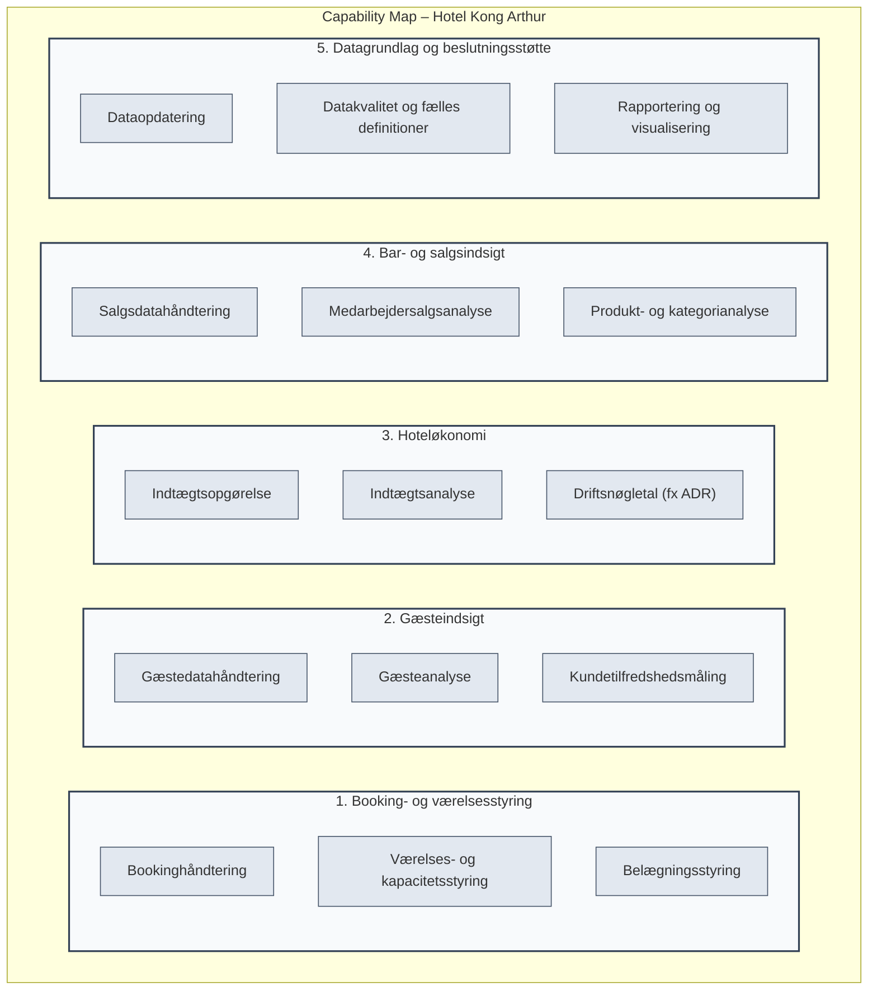

# Capability map – Hotel Kong Arthur

**Feature**: [spec.md](./spec.md) | **Plan**: [plan.md](./plan.md) | **Tasks**: [tasks.md](./tasks.md)  
**Branch**: `specify` | **Dato**: 2026-10-29  
**Status**: Ratificeret  

---

## Formål
At vise, hvilke forretningsevner der skal understøttes for at håndtere bookinger og bruge hotel- og bardata til beslutninger.

Kortet er afgrænset til den tværfaglige opgave. Det er et forslag til ønskede evner, ikke en vurdering af, hvor modne hotellets nuværende evner er. En capability beskriver hvad organisationen skal kunne – ikke processen eller det konkrete system.

---

## Visuelt overblik over kapabiliteter

---

## Kort over kapabiliteter

| Niveau 1: Område | Niveau 2: Kapabiliteter | Hvad evnen skal understøtte |
| :--- | :--- | :--- |
| **1. Booking- og værelsesstyring** | **Bookinghåndtering** | Oprettelse, ændring og sletning af bookinger |
| | **Værelses- og kapacitetsstyring** | Overblik over værelser, typer og tilgængelig kapacitet |
| | **Belægningsstyring** | Overblik over optagne og tilgængelige værelsesnætter |
| **2. Gæsteindsigt** | **Gæstedatahåndtering** | Håndtering af relevante gæsteoplysninger og lande |
| | **Gæsteanalyse** | Indsigt i, hvor gæsterne kommer fra |
| | **Kundetilfredshedsmåling** | Måling af tilfredshed, hvis datagrundlag og krav afklares |
| **3. Hoteløkonomi** | **Indtægtsopgørelse** | Opgørelse af hotellets indtjening for et valgt år |
| | **Indtægtsanalyse** | Sammenligning af indtjening på værelser eller typer, sæsoner og lande |
| | **Driftsnøgletal** | Beregning af belægningsgrad og et selvvalgt nøgletal, fx ADR |
| **4. Bar- og salgsindsigt** | **Salgsdatahåndtering** | Registrering eller indlæsning af salg med medarbejder, produkt, antal og beløb |
| | **Medarbejdersalgsanalyse** | Opgørelse af Helene Christines samlede årssalg |
| | **Produkt- og kategorianalyse** | Omsætning pr. drink og fordeling mellem cocktails og kaffe |
| **5. Datagrundlag og beslutningsstøtte** | **Dataopdatering** | Nye og ændrede oplysninger kan indgå i analyserne |
| | **Datakvalitet og fælles definitioner** | Konsistente data, perioder og beregningsregler |
| | **Rapportering og visualisering** | Interaktive visninger, filtre og sammenligninger til beslutningstagere |

*Kortet tager udgangspunkt i PDF’ens krav og den eksisterende roadmap. Roadmapen beskriver også, at kundetilfredshed og flere beregningsdefinitioner skal afklares nærmere.*

---

## Kobling til projektets løsning

| Capability | Hvordan prototypen kan understøtte den |
| :--- | :--- |
| **Bookinghåndtering** | Browserfrontend med opret, redigér og slet via REST API |
| **Dataopdatering og datakvalitet** | Validering i backend og lagring i MySQL |
| **Hoteløkonomi og barindsigt** | Definerede beregninger og data tilgængelige via API |
| **Rapportering og visualisering** | Tableau-dashboard med udgangspunkt i backendens REST API |

*Backend, MySQL, API og Tableau er tekniske understøttelser – ikke capabilities i sig selv. Løsningen skal demonstrere et sammenhængende flow fra ændrede data til opdateret visning.*

---

## Prioritering i miniprojektet

1. **Fundament**: Bookinghåndtering, opdaterede data og en fungerende forbindelse til Tableau.
2. **Påkrævede analyser**: Gæstelande, hotelindtjening og Helene Christines barsalg.
3. **Kvalitet og afklaring**: Fælles KPI-definitioner, test af beregninger og afklaring af kundetilfredshed.

> **Bemærkning vedr. AS-IS modenhed**:  
> Før I laver et modenheds-heatmap, skal I undersøge den faktiske AS-IS. Materialet dokumenterer ikke nok til at give Hotel Kong Arthurs nuværende capabilities en pålidelig modenhedsscore. Roadmapen fravælger i øvrigt capability mapping som obligatorisk leverance; dette kort er derfor et supplerende analyseværktøj, ikke et ekstra PDF-krav.
