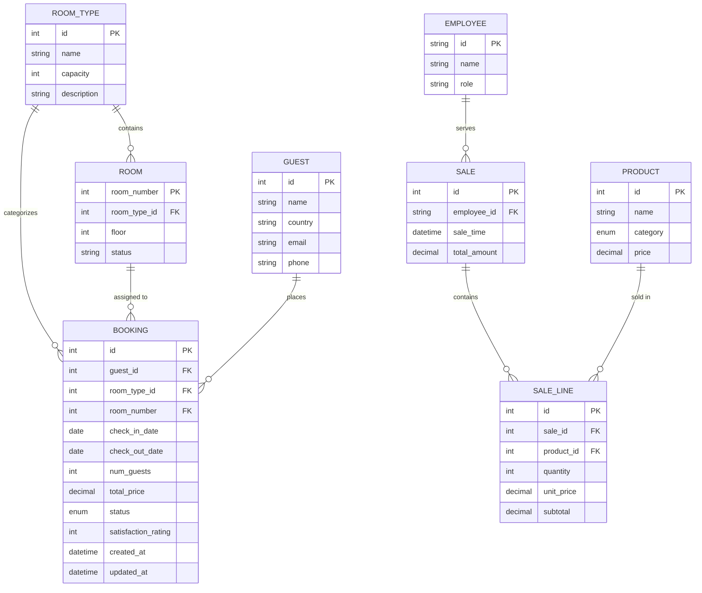

# Phase 1: Data Model & Database Architecture

**Feature**: [spec.md](./spec.md) | **Feature Directory**: `specs/001-hotel-management`  
**Date**: 2026-10-29  
**Database**: MySQL 8.0  
**Status**: Completed

Dette dokument definerer den relationelle datamodel, tabeller, fremmednøgler, forretningsregler og seed-strategi for Hotel Kong Arthur-systemet (SCAMM).

---

## 1. Konceptuel ER-Model



---

## 2. Tabeldefinitioner & Integritetsregler

### 2.1 `room_types` (De 8 officielle værelseskategorier)
- **Formål**: Indeholder hotellets 8 faste værelsestyper.
- **Felter**:
  - `id` (INT, PK, AUTO_INCREMENT)
  - `name` (VARCHAR(100), NOT NULL, UNIQUE)
  - `capacity` (INT, NOT NULL, DEFAULT 2) — Maksimal personkapacitet (1–4)
  - `base_price_indicative` (VARCHAR(100), NULL) — Vejledende prisinterval fra opgaven (kun information)

**Faste data (8 rækker)**:
1. `Standard enkeltværelse` (Kapacitet: 1, Vejl: 900–1.200 DKK)
2. `Grand lit værelse` (dobbelt økonomi) (Kapacitet: 2, Vejl: 1.100–1.400 DKK)
3. `Standard dobbeltværelse` (Kapacitet: 2, Vejl: 1.200–1.600 DKK)
4. `Superior dobbeltværelse` (Kapacitet: 3, Vejl: 1.400–2.000 DKK)
5. `Junior suite` (Kapacitet: 4, Vejl: 1.800–2.500 DKK)
6. `Spa executive` (Kapacitet: 2, Vejl: 2.000–2.800 DKK)
7. `Suite` (Kapacitet: 4, Vejl: 2.500–3.500 DKK)
8. `LOFT suite` (Kapacitet: 4, Vejl: 3.000–4.000 DKK)

---

### 2.2 `rooms` (De 214 fysiske værelser)
- **Formål**: Registrering af hotellets samlede verificerede værelsesbestand (grundlag for belægningsgrad).
- **Felter**:
  - `room_number` (INT, PK) — Værelsesnumre (f.eks. 101–425)
  - `room_type_id` (INT, NOT NULL, FK $\rightarrow$ `room_types.id`)
  - `floor` (INT, NOT NULL) — 1. til 4. etage
  - `status` (ENUM('available', 'occupied', 'maintenance'), NOT NULL, DEFAULT 'available')

**Integritetsregel**: Der skal være præcis **214 værelser** oprettet i seed-data for at sikre, at kapacitetsberegninger til enhver tid er retvisende.

---

### 2.3 `guests` (Gæster og lande)
- **Formål**: Registrering af gæstens oplysninger og bopælsland/nationalitet.
- **Felter**:
  - `id` (INT, PK, AUTO_INCREMENT)
  - `name` (VARCHAR(150), NOT NULL)
  - `country` (VARCHAR(100), NULL) — Gæstens kontaktland (hvis NULL, grupperes under "Ukendt")
  - `email` (VARCHAR(150), NULL)
  - `phone` (VARCHAR(50), NULL)
  - `created_at` (DATETIME, NOT NULL, DEFAULT CURRENT_TIMESTAMP)

---

### 2.4 `bookings` (Reservationer og ophold)
- **Formål**: Kerneenhed for overnatninger, CRUD-håndtering og omsætningsberegninger.
- **Felter**:
  - `id` (INT, PK, AUTO_INCREMENT)
  - `guest_id` (INT, NOT NULL, FK $\rightarrow$ `guests.id`)
  - `room_type_id` (INT, NOT NULL, FK $\rightarrow$ `room_types.id`)
  - `room_number` (INT, NULL, FK $\rightarrow$ `rooms.room_number`) — Valgfrit tildelt værelse
  - `check_in_date` (DATE, NOT NULL)
  - `check_out_date` (DATE, NOT NULL)
  - `num_guests` (INT, NOT NULL, CHECK `num_guests >= 1 AND num_guests <= 4`)
  - `total_price` (DECIMAL(10,2), NOT NULL, CHECK `total_price >= 0`) — Faktisk aftalt totalbeløb i DKK
  - `status` (ENUM('confirmed', 'cancelled', 'completed'), NOT NULL, DEFAULT 'confirmed')
  - `satisfaction_rating` (TINYINT, NULL, CHECK `satisfaction_rating BETWEEN 1 AND 5`)
  - `created_at` (DATETIME, NOT NULL, DEFAULT CURRENT_TIMESTAMP)
  - `updated_at` (DATETIME, NOT NULL, DEFAULT CURRENT_TIMESTAMP ON UPDATE CURRENT_TIMESTAMP)

**Validerings- og Forretningsregler**:
1. `check_out_date > check_in_date` (afvises ellers af database constraint / service-lag).
2. Sletning udføres som **Soft Delete**: `UPDATE bookings SET status = 'cancelled' WHERE id = ?`.
3. Beregning af overnatninger: $\text{Nætter} = \text{DATEDIFF}(check\_out\_date, check\_in\_date)$. Check-out dagen tæller **ikke** som en overnatning.

---

### 2.5 `employees` (Hotellets personale)
- **Formål**: Registrering af ansatte for at muliggøre medarbejderfiltrering i baren.
- **Felter**:
  - `id` (VARCHAR(20), PK) — F.eks. `HC01` for Helene Christine
  - `name` (VARCHAR(100), NOT NULL)
  - `role` (VARCHAR(100), NOT NULL)

**Faste data**:
- `HC01`: Helene Christine (Receptionist & Bartender)
- `BM02`: Barskift 2 (Bartender)
- `BM03`: Barskift 3 (Bartender)

---

### 2.6 `products` (Lobbybarens menukort)
- **Formål**: Registrering af menukortet i lobbybaren.
- **Felter**:
  - `id` (INT, PK, AUTO_INCREMENT)
  - `name` (VARCHAR(100), NOT NULL, UNIQUE)
  - `category` (ENUM('cocktail', 'coffee', 'wine', 'beer', 'snack'), NOT NULL)
  - `price` (DECIMAL(10,2), NOT NULL, CHECK `price >= 0`)

**Dataomfang**:
- **20 forskellige cocktails** (f.eks. *Espresso Martini*, *Old Fashioned*, *Mojito*, *Gin Hass*, *Aviation*...)
- **10 forskellige kaffetyper** (f.eks. *Espresso*, *Americano*, *Caffè Latte*, *Cappuccino*, *Cortado*, *Flat White*...)
- Udvalgte vine, øl og snacks.

---

### 2.7 `sales` og `sale_lines` (Barsalgstransaktioner)
- **Formål**: Fintmasket transaktionsdata for baren, der muliggør både medarbejder-, volumen- og produktanalyser.
- **`sales` Felter**:
  - `id` (INT, PK, AUTO_INCREMENT)
  - `employee_id` (VARCHAR(20), NOT NULL, FK $\rightarrow$ `employees.id`)
  - `sale_time` (DATETIME, NOT NULL, DEFAULT CURRENT_TIMESTAMP)
  - `total_amount` (DECIMAL(10,2), NOT NULL, DEFAULT 0.00)
- **`sale_lines` Felter**:
  - `id` (INT, PK, AUTO_INCREMENT)
  - `sale_id` (INT, NOT NULL, FK $\rightarrow$ `sales.id` ON DELETE CASCADE)
  - `product_id` (INT, NOT NULL, FK $\rightarrow$ `products.id`)
  - `quantity` (INT, NOT NULL, CHECK `quantity >= 1`)
  - `unit_price` (DECIMAL(10,2), NOT NULL)
  - `subtotal` (DECIMAL(10,2), NOT NULL) — Beregnet som `quantity * unit_price`

---

## 3. Sæsontilknytning & Beregningslogik i SQL

For at fordele overnatninger på sæsoner anvender forretningslaget og databaseforespørgslerne følgende datologik for en given overnatningsdato $D$:

```sql
CASE 
    WHEN MONTH(D) IN (11, 12, 1, 2) THEN 'Lavsæson'
    WHEN MONTH(D) IN (3, 4, 5, 9, 10) THEN 'Mellemsæson'
    WHEN MONTH(D) IN (6, 7, 8) THEN 'Højsæson'
END AS season_name
```

### Håndtering af ophold over sæson- eller årsskifte:
Ved hjælp af en dato-tabel (`calendar_dates`) eller en rekursiv CTE genereres én række pr. overnatning:
$$\text{Datoer for booking: } [\text{check\_in\_date}, \dots, \text{check\_out\_date} - 1 \text{ dag}]$$
Hver enkelt overnatning tilskrives dagsprisen $\frac{\text{total\_price}}{\text{antal nætter}}$ og kategoriseres i den specifikke nat's sæson og kalenderår. Derved opnås 100 % nøjagtig fordeling uden afrundingsfejl.
